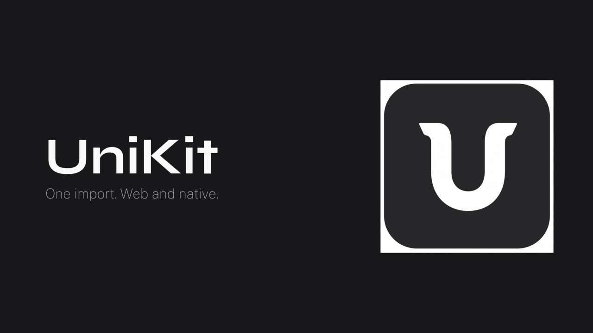

# UniKit UI

**English** · [한국어](README.ko.md)

<p align="center">
  
</p>

> "I want one import that looks the same on React and React Native, like HeroUI.
> The shape should be like shad/cn." — original request

**One import** for UI that looks the same on React (web) and React Native. The full shadcn/ui (new-york-v4) catalog — **61 components** — ported universally, plus the original **EditorToolbar** (62 total). Package name: `@unikit-bridge/ui`.

| | |
|---|---|
| Single source | Components use bridge primitives (`View` · `Text` · `Pressable` …) + `className` only. Package export conditions handle the platform split |
| Same look | Zinc-family CSS variable tokens (light/dark) on both platforms |
| Two ways to consume | npm install, or copy sources with the shadcn CLI |

Commands below were run successfully from the repo root.

## Requirements

- [bun](https://bun.sh) 1.4.4+ (this repo is a bun workspace — no pnpm)

## Quick start

From the repository root:

```bash
bun install
bun run typecheck
```

### Web demo (Next.js)

```bash
cd apps/web && bun run dev -p 3000
```

| Path | What |
|---|---|
| <http://localhost:3000/> | Landing |
| <http://localhost:3000/components> | Component catalog |
| <http://localhost:3000/components/button> | Component docs example |
| <http://localhost:3000/blocks> | Blocks (composed screens) |
| <http://localhost:3000/r/registry.json> | shadcn registry |

Demo & registry: <https://ui.ll3.kr> — redeploy notes in [apps/web/DEPLOY.md](apps/web/DEPLOY.md)

### Expo demo

Compare as a web bundle:

```bash
cd apps/expo && bun x expo export --platform web
cd ../..
bunx serve apps/expo/dist -l 8081
```

→ <http://localhost:8081> (run `serve` from the **repo root**). Physical devices: [docs/expo-go.md](docs/expo-go.md) (Korean).

## Use in your project

Full install steps: **[docs/install.en.md](docs/install.en.md)** (Korean: [docs/install.md](docs/install.md)).

**Option 1 — npm**

```bash
bun add @unikit-bridge/ui class-variance-authority clsx tailwind-merge
```

Web: Tailwind v4 + `@source` / `web:` variants + `lucide-react`. Native: uniwind + `lucide-react-native`. Tokens via the registry `theme` item or [packages/unikit/README.md](packages/unikit/README.md).

```tsx
"use client";

import { UnikitThemeProvider, Button, Card, CardContent } from "@unikit-bridge/ui";

export default function Home() {
  return (
    <UnikitThemeProvider defaultColorScheme="light">
      <Card>
        <CardContent className="gap-2">
          <Button variant="default">Default</Button>
        </CardContent>
      </Card>
    </UnikitThemeProvider>
  );
}
```

> npm `@unikit-bridge/ui` 0.5.0 ships all **62** components (61 barrel + `@unikit-bridge/ui/chart`) plus the `@unikit-bridge/ui/editor` engine entry point (web: tiptap directly, native: bundled WebView) and the `@unikit-bridge/ui/behaviors` interaction-hooks entry point. **Option 2 (registry copy)** still applies when you want to own and edit the component source — the editor entry point is npm-only, since its engine HTML bundle is a build artifact.

**A2UI renderer** — `@unikit-bridge/ui/a2ui` renders [A2UI](https://a2ui.org) v1.0 agent messages with the same 62 components on web and React Native: `createA2uiProcessor` + `createUnikitCatalog` drive the headless `@a2ui/web_core` pipeline, `UnikitA2uiSurface` mounts the resolved tree. `@unikit-bridge/ui/a2ui/optional` opts into the `Chart` and `Form` components (pulls `react-hook-form`; the base entry stays free of it). Demo: `/a2ui` in the web app, `/demo/a2ui` in the Expo app.

**Option 2 — source copy (summary)**

```bash
bunx shadcn@latest add https://ui.ll3.kr/r/button.json -y
```

`transpilePackages` · `web:` / `@source` · `theme.json` — see [docs/install.en.md](docs/install.en.md). Registry items: 71 = UI 62 + lib 3 (utils · overlay · menu-nav) + theme 4 + style 2 (animations · editor-prose).

**Agents — MCP server**

```bash
claude mcp add unikit-bridge -- npx -y @unikit-bridge/mcp
```

`@unikit-bridge/mcp` is the family server (it lives in the [unikit-bridge portal repo](https://github.com/loopy-lim/unikit), `packages/mcp`). For UniKit UI it bundles the registry snapshot (71 items — full sources plus theme tokens & CSS) and this repo's `llms.txt`, so it runs with zero network at runtime. Tools: `search_items` · `view_item` · `get_install_command` · `get_docs`.

## Contributing (add a component)

Sources are **two trees** — `packages/unikit/src/` (monorepo) and `registry/` (copy for consumers). Bodies must match; only imports differ.

1. Write under `src/components/` → export from `src/index.ts`
2. Copy to `registry/ui/` (`cn` → `@/lib/utils`)
3. Register in `registry.json`

After token edits:

```bash
bun run generate:design
bun run audit:design
```

Porting rules and checks: **[AGENTS.md](AGENTS.md)** (Korean).

## Repository layout

```text
unikit-ui/
├── apps/expo/           # Expo demo (showcase · blocks, uniwind)
├── apps/web/            # Next.js demo (landing · /components · /blocks · /r/)
├── packages/unikit/     # @unikit-bridge/ui (src + registry + registry.json)
├── docs/                # Guides · install · roadmap · SDD
├── shadcn-ref/          # Upstream reference (do not edit)
└── AGENTS.md            # Agent / contributor rules
```

Both demos render the same screens via `@unikit-bridge/ui`.

## Docs

| Doc | Contents |
|---|---|
| [README.ko.md](README.ko.md) | Quick start (Korean) |
| [docs/install.en.md](docs/install.en.md) | Consumer install (English) |
| [docs/install.md](docs/install.md) | Consumer install (Korean) |
| [docs/components.md](docs/components.md) | Props · variants · a11y (Korean) |
| [docs/roadmap-components.md](docs/roadmap-components.md) | Port history · gaps · landscape (Korean) |
| [packages/unikit/README.md](packages/unikit/README.md) | npm package docs (English) |
| [packages/unikit/docs/tokens.md](packages/unikit/docs/tokens.md) | Token catalog (generated) |
| [llms.txt](llms.txt) | Summary for AI tools |
| [AGENTS.md](AGENTS.md) | Contribute · verify · port rules |

## Known limits

- **Native on device** — CI covers web / bundle builds. Use [docs/expo-go.md](docs/expo-go.md) for hardware.
- **Unsupported behaviors** — overlay exit animations (enter animations supported on web), native hover open, chart responsive/dark, etc. See [docs/roadmap-components.md](docs/roadmap-components.md).
- **A2UI** — media components (`Video` · `AudioPlayer`) render content without captions or transport controls; `Chart` covers `line` · `bars` only; `Calendar` exposes single-date ISO selection. Function-valued props serialize poorly, so catalog contracts replace them with value bindings + actions. Details in [docs/roadmap-components.md](docs/roadmap-components.md) «A2UI 렌더러».
- **Icon peers** — web `lucide-react`, native `lucide-react-native` (bridged). Components never import Lucide directly.
