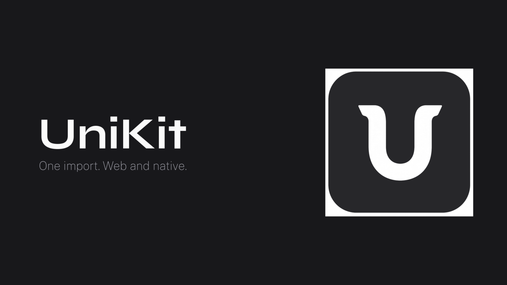

# UniKit

**한국어** · [English](README.en.md)

<p align="center">
  
</p>

> "HeroUI처럼 한개의 import로 react, react-native에서 두개 같이 보이게 만들고 싶어.
> 형태는 shad/cn 처럼 이루어지게 하면 좋을꺼 같아." — 이 프로젝트의 원 요청

**import 하나**로 React(웹)와 React Native에서 같은 모습의 UI를 쓰는 컴포넌트 모음이에요. shadcn/ui(new-york-v4) 카탈로그 **61종**을 유니버설로 이식했고, 패키지명은 `@unikit-bridge/ui`예요.

| | |
|---|---|
| 한 벌 소스 | 컴포넌트는 브리지 프리미티브(`View`·`Text`·`Pressable`…) + `className`만 사용. 플랫폼 분기는 패키지 exports가 담당 |
| 같은 디자인 | zinc 계열 CSS 변수 토큰(라이트/다크)으로 웹·네이티브 동일 룩 |
| 두 가지 소비 | npm 설치, 또는 shadcn CLI로 소스 복사 |

안내·명령은 한글로 적었고, 루트에서 실행해 확인한 것만 적어요.

## 필요한 것

- [bun](https://bun.sh) 1.4.4 이상 (이 저장소는 bun 워크스페이스 — pnpm 금지)

## 빠른 시작

저장소 루트에서:

```bash
bun install
bun run typecheck
```

### 웹 데모 (Next.js)

```bash
cd apps/web && bun run dev -p 3000
```

| 경로 | 내용 |
|---|---|
| <http://localhost:3000/> | 소개 랜딩 |
| <http://localhost:3000/components> | 컴포넌트 카탈로그 |
| <http://localhost:3000/components/button> | 컴포넌트 문서 예 |
| <http://localhost:3000/components/kitchen-sink> | 전체 스크롤 데모 |
| <http://localhost:3000/blocks> | 블록(조합 화면) |
| <http://localhost:3000/r/registry.json> | shadcn 레지스트리 |

데모·레지스트리: <https://ui.unikit.ll3.kr> — 재배포는 [apps/web/DEPLOY.md](apps/web/DEPLOY.md)

### Expo 데모

웹 번들로 비교하려면:

```bash
cd apps/expo && bun x expo export --platform web
cd ../..
bunx serve apps/expo/dist -l 8081
```

→ <http://localhost:8081> (`serve`는 **저장소 루트**에서 실행). 실물 기기는 [docs/expo-go.md](docs/expo-go.md).

## 내 프로젝트에서 쓰기

상세 절차·설정·테마 프리셋은 **[docs/install.md](docs/install.md)** 에 있어요.

**방법 1 — npm**

```bash
bun add @unikit-bridge/ui class-variance-authority clsx tailwind-merge
```

웹은 Tailwind v4 + `@source`/`web:` 변형 + `lucide-react`, 네이티브는 uniwind + `lucide-react-native`. 토큰은 레지스트리 `theme` 항목으로 받거나 [packages/unikit/README.md](packages/unikit/README.md)를 따르세요.

```tsx
"use client";

import { UnikitThemeProvider, Button, Card, CardContent } from "@unikit-bridge/ui";

export default function Home() {
  return (
    <UnikitThemeProvider defaultColorScheme="light">
      <Card>
        <CardContent className="gap-2">
          <Button variant="default">기본 버튼</Button>
        </CardContent>
      </Card>
    </UnikitThemeProvider>
  );
}
```

> npm `@unikit-bridge/ui` 0.3.0부터 61종 전량(배럴 60종 + `@unikit-bridge/ui/chart`)을 제공해요. 소스를 직접 소유하려면 **방법 2(레지스트리 복사)** 를 쓰세요.

**방법 2 — 소스 복사 (요약)**

```bash
bunx shadcn@latest add https://ui.unikit.ll3.kr/r/button.json -y
```

`transpilePackages` · `web:`/`@source` · `theme.json` 설정은 [docs/install.md](docs/install.md). 레지스트리 아이템 67종 = UI 61 + utils 1 + theme 4 + animations 1.

## 기여 (저장소에 컴포넌트 추가)

소스는 **두 벌**이에요 — `packages/unikit/src/`(모노레포)와 `registry/`(소비자 복사). 본문은 같고 import만 달라야 해요.

1. `src/components/`에 작성 → `src/index.ts` export
2. `registry/ui/`에 복사(`cn` → `@/lib/utils`)
3. `registry.json` 등록

토큰을 바꿨으면:

```bash
bun run generate:design
bun run audit:design
```

이식 규칙·검증·금지 사항은 **[AGENTS.md](AGENTS.md)** 를 보세요.

## 저장소 구조

```text
UniKit/
├── apps/expo/           # Expo 데모(쇼케이스·블록, uniwind)
├── apps/web/            # Next.js 데모(랜딩·/components·/blocks·레지스트리 /r/)
├── packages/unikit/     # @unikit-bridge/ui (src + registry + registry.json)
├── docs/                # 사용법·설치·로드맵·SDD
├── shadcn-ref/          # 이식 원본(수정 금지)
└── AGENTS.md            # 에이전트·기여자 지침
```

두 데모 앱은 같은 import(`@unikit-bridge/ui`)로 같은 화면을 렌더해요.

## 문서

| 문서 | 내용 |
|---|---|
| [docs/install.md](docs/install.md) | 소비자 설치(npm·레지스트리 복사) 상세 |
| [README.en.md](README.en.md) / [docs/install.en.md](docs/install.en.md) | 영어 빠른 시작·설치 |
| [docs/components.md](docs/components.md) | 61종 Props·변형·접근성 |
| [docs/roadmap-components.md](docs/roadmap-components.md) | 이식 이력·미지원 로드맵·경쟁 현황 |
| [docs/expo-go.md](docs/expo-go.md) | 스마트폰 Expo Go 실물 확인 |
| [packages/unikit/README.md](packages/unikit/README.md) | npm 패키지 문서(영어) |
| [packages/unikit/docs/tokens.md](packages/unikit/docs/tokens.md) | 토큰 카탈로그(자동 생성) |
| [llms.txt](llms.txt) | AI 도구용 요약 |
| [AGENTS.md](AGENTS.md) | 기여·검증·이식 규칙 |
| [docs/sdd/](docs/sdd/) | 개발 과정 문서 |

## 알려진 한계

- **실물 네이티브** — CI는 웹·번들 빌드까지. 기기 화면은 [docs/expo-go.md](docs/expo-go.md)로 확인하세요.
- **미지원 기능** — 오버레이 퇴장 애니메이션(진입 애니메이션만 웹 지원), 네이티브 hover 개방, chart 반응형·다크 등. 목록은 [docs/roadmap-components.md](docs/roadmap-components.md).
- **아이콘 peer** — 웹 `lucide-react`, 네이티브 `lucide-react-native`(브리지가 감쌈). 컴포넌트는 lucide를 직접 import하지 않아요.
